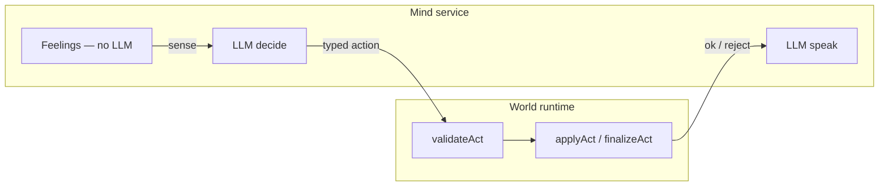

# Olle

Private autonomous companion — **Phase 1 MVP**: mind loop, read-only dashboard, inbound offerings, email rate limits + quiet hours, permission gate, optional Resend (mock without API keys).

## Architecture (Pino-shaped)



```
packages/protocol/   Typed action manifest
apps/mind/           Mind loop + world/runtime (validate before speak)
```

| Step | What | LLM? |
|------|------|------|
| **Feel** | Mood / energy / needs each tick; setbacks ~7.5× wins | **No** |
| **Sense** | Observations JSON for decide | **No** |
| **Decide** | One `action_id` + params + `because` from allow-list | Only if salient (or interval) |
| **World** | `validateAct` then `applyAct` — mind proposes, world accepts/rejects | **No** |
| **Speak** | Voice **after** world result; locked action, no re-choice | Second call |
| **Sleep** | Consolidation batch only; no decide/speak | **No** |

Feed entries follow Pino kinds: `did` / `noticed` / `felt` / `mind` with `why`, `ok`, `about`, `change`.

**Placement:** Olle defaults to `{ status: "unplaced" }`. Mind ticks run fully while unplaced (private diary, rest, email stubs). Class C in Phase 0 is **shared diary proposals only** — no map pins or physical-world UI.

**World state:** JSON file (default `.olle-state.json` in cwd) — private diary, feed, permission queue, shared diary entries (pending until approved).

**Class D** actions (e.g. `add_map_pin`) exist in the manifest but are **blocked in code**.

## Olle is ready when…

1. `cp .env.example .env` — secrets only in `.env` (never committed).
2. `npm install && npm run build && npm test` — all green.
3. `npm start` — mind loop, inbound webhook, and dashboard at `http://127.0.0.1:8787/dashboard`.
4. Without API keys — heuristic mind still ticks; with `OPENAI_API_KEY` (default) or `ANTHROPIC_API_KEY` — LLM decide/speak.
5. Permission E2E — Class C → email mock or Resend → `olle permit approve <id>` **or** inbound `YES <id>` → shared diary `published`.

Details: [docs/olle-ready.md](docs/olle-ready.md).

## Quick start

```bash
cp .env.example .env   # set WILLIAM_EMAIL at minimum
npm install
npm run build
npm test
npm start            # live Olle (tick loop + inbound server)
```

One-shot tick (debug):

```bash
npm run tick
npm run olle -- status
```

Inbound permission reply (local dev):

```bash
curl -X POST http://127.0.0.1:8787/webhooks/email/inbound \
  -H 'content-type: application/json' \
  -d '{"from":"you@example.com","text":"YES req-abc123"}'
```

CLI permissions:

```bash
npm run olle -- permit approve <request-id>
npm run olle -- permit deny <request-id>
```

## AI architecture (decide-then-speak, Pino-first)

Matches [Pino Protocol](https://protocol.pinos.world/) ordering: **world validates the act before speak text is generated**.

1. **Decide** (`HeuristicProvider` | `OpenAiProvider` | `AnthropicProvider`) — feelings, legal manifest actions, memory snippets. Output `{ action_id, params, because }`; world `validateAct` runs next (not inside the LLM).
2. **World** — `applyAct` mutates state / permission queue; failures log `did` with `ok: false`.
3. **Speak** — separate call with **locked** action + `world_ok`; must not pick a new action. Prose hits the world in `finalizeAct` (diary lines, email bodies).

**Idle fallback (~half of Pino ticks):** continuing the same activity with nothing salient → `continue_activity` with **no decide LLM**.

**Asleep:** feelings tick only; optional consolidation job; **zero** decide/speak inference.

| Variable | Default | Purpose |
|----------|---------|---------|
| `OPENAI_API_KEY` | — | Enables ChatGPT (OpenAI API) — **preferred** |
| `ANTHROPIC_API_KEY` | — | Enables Claude (alternative) |
| `OLLE_LLM_PROVIDER` | `openai` if OpenAI key set, else `anthropic` if Anthropic key, else `heuristic` | `openai` \| `anthropic` \| `heuristic` |
| `OLLE_DECIDE_MODEL` | `gpt-4o-mini` (OpenAI) or `claude-haiku-4-5-20251001` (Anthropic) | Fast structured decide |
| `OLLE_SPEAK_MODEL` | `gpt-4o-mini` (OpenAI) or `claude-sonnet-4-5-20250929` (Anthropic) | Character speak; try `gpt-4o` for richer OpenAI speak only |

**Rough cost (personal use):** With idle skip, expect on the order of tens of decide calls per day → well under a dollar/day on `gpt-4o-mini` / Haiku decide + occasional `gpt-4o` or Sonnet speak. Continuous 30s ticks without salience mostly cost **zero** LLM tokens.

No API keys → full **heuristic** path (no network, deterministic).

## Environment variables

See **`.env.example`** for every variable. Highlights:

| Variable | Purpose |
|----------|---------|
| `WILLIAM_EMAIL` | Outbound to William; inbound allow-list default |
| `OLLE_INBOUND_ALLOWLIST` | Comma-separated inbound senders |
| `OLLE_INBOUND_PORT` | Default `8787` |
| `RESEND_API_KEY` + `OLLE_EMAIL_FROM` | Real outbound (both required with `WILLIAM_EMAIL`) |
| `OLLE_STATE_PATH` / `OLLE_TICK_MS` | State file and tick interval |
| `OLLE_QUIET_HOURS` / `OLLE_QUIET_TZ` | Proactive email quiet window (default Oslo) |

Mock outbound logs `[mock-email] WOULD SEND` when Resend is not fully configured.

## Actions (Phase 0)

- **Class A:** `continue_activity`, `feel_and_note`, `rest`, `think_about`, `remember`, `read_world`, `draft_email`, `sleep`
- **Class B:** `append_private_diary`, `notify_william`
- **Class C:** `propose_shared_diary_entry` (permission-gated)
- **Class D:** `add_map_pin` — blocked

## Resend (outbound + inbound)

**Outbound:** set `RESEND_API_KEY`, `OLLE_EMAIL_FROM`, and `WILLIAM_EMAIL`.

**Inbound:** `npm start` exposes `POST /webhooks/email/inbound`. Route Resend inbound (or ngrok) to that path; body may be Resend JSON or `{ "from", "text" }`. Non-permission mail becomes **offerings** (queued for Sense).

**Dashboard (Phase 1):** `GET /`, `/dashboard`, `/api/now`, `/api/feed`, `/api/audit` on the same port as inbound.

**Talk to Olle:** `GET /chat`, `POST /api/message` `{ "text": "..." }` (localhost or `OLLE_MESSAGE_TOKEN`), CLI `npm run olle -- say "hei olle"`. Replies land in `conversation` on the next mind tick (`reply_to_william`).

## Repo layout

```text
apps/mind/
packages/protocol/
```

See Project store `docs/olle-companion-plan.md` for full product spec.
