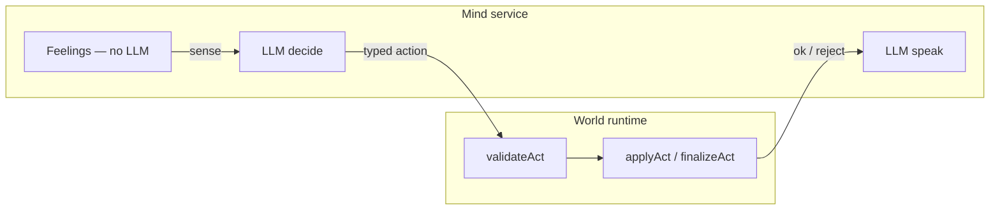

# Olle

Private autonomous companion — Phase 0: runnable mind loop, permission gate, optional email (mock without API keys).

## Architecture (Pino-shaped)



```
packages/protocol/   Typed action manifest
apps/mind/           Mind loop + world/runtime (validate before speak)
```

| Step | What | LLM? |
|------|------|------|
| **Feel** | Mood / energy / needs each tick; setbacks ~7.5× wins | **No** |
| **Sense** | Observations JSON for decide | **No** |
| **Decide** | One `action_id` + params + `because` from allow-list | Only if salient (or interval) |
| **World** | `validateAct` then `applyAct` — mind proposes, world accepts/rejects | **No** |
| **Speak** | Voice **after** world result; locked action, no re-choice | Second call |
| **Sleep** | Consolidation batch only; no decide/speak | **No** |

Feed entries follow Pino kinds: `did` / `noticed` / `felt` / `mind` with `why`, `ok`, `about`, `change`.

**Placement:** Olle defaults to `{ status: "unplaced" }`. Mind ticks run fully while unplaced (private diary, rest, email stubs). Class C in Phase 0 is **shared diary proposals only** — no map pins or physical-world UI.

**World state:** JSON file (default `.olle-state.json` in cwd) — private diary, feed, permission queue, shared diary entries (pending until approved).

**Class D** actions (e.g. `add_map_pin`) exist in the manifest but are **blocked in code**.

## Quick start

```bash
npm install
npm run build
npm test
npm run tick          # one mind tick
npm run olle -- tick  # same via CLI wrapper
```

Continuous loop (30s default):

```bash
OLLE_TICK_MS=15000 npx tsx apps/mind/src/tick-loop.ts
```

Permissions:

```bash
npm run olle -- status
npm run olle -- permit approve <request-id>
npm run olle -- permit deny <request-id>
```

## AI architecture (decide-then-speak, Pino-first)

Matches [Pino Protocol](https://protocol.pinos.world/) ordering: **world validates the act before speak text is generated**.

1. **Decide** (`HeuristicProvider` | `AnthropicProvider`) — feelings, legal manifest actions, memory snippets. Output `{ action_id, params, because }`; world `validateAct` runs next (not inside the LLM).
2. **World** — `applyAct` mutates state / permission queue; failures log `did` with `ok: false`.
3. **Speak** — separate call with **locked** action + `world_ok`; must not pick a new action. Prose hits the world in `finalizeAct` (diary lines, email bodies).

**Idle fallback (~half of Pino ticks):** continuing the same activity with nothing salient → `continue_activity` with **no decide LLM**.

**Asleep:** feelings tick only; optional consolidation job; **zero** decide/speak inference.

| Variable | Default | Purpose |
|----------|---------|---------|
| `ANTHROPIC_API_KEY` | — | Enables Claude |
| `OLLE_LLM_PROVIDER` | `anthropic` if key set, else `heuristic` | `anthropic` \| `heuristic` \| `openai` (stub) |
| `OLLE_DECIDE_MODEL` | `claude-haiku-4-5-20251001` | Fast structured decide |
| `OLLE_SPEAK_MODEL` | `claude-sonnet-4-5-20250929` | Character speak |

**Rough cost (personal use):** With idle skip, expect on the order of tens of decide calls per day → well under a dollar/day on Haiku decide + occasional Sonnet speak. Continuous 30s ticks without salience mostly cost **zero** LLM tokens.

No `ANTHROPIC_API_KEY` → full **heuristic** path (no network, deterministic).

## Environment variables

| Variable | Purpose |
|----------|---------|
| `OLLE_STATE_PATH` | Path to JSON state (default: `./.olle-state.json`) |
| `OLLE_TICK_MS` | Loop interval when running `tick-loop.ts` |
| `OLLE_VERBOSE` | `1` logs mock email subjects |
| `RESEND_API_KEY` | Real outbound email via Resend |
| `OLLE_EMAIL_FROM` | From address (e.g. `olle@yourdomain.com`) |
| `WILLIAM_EMAIL` | Recipient allow-list default |

See **AI architecture** above for LLM env vars. Without keys, Olle runs in **dry/mock mode** (heuristic decide + mock email).

## Actions (Phase 0)

- **Class A:** `continue_activity`, `feel_and_note`, `rest`, `think_about`, `remember`, `read_world`, `draft_email`, `sleep`
- **Class B:** `append_private_diary`, `notify_william`
- **Class C:** `propose_shared_diary_entry` (permission-gated)
- **Class D:** `add_map_pin` — blocked

## Resend (not wired in Phase 0 beyond adapter)

To send real email, set `RESEND_API_KEY` and `OLLE_EMAIL_FROM`. Inbound webhooks and YES/NO parsing from email are **not** hooked to HTTP yet; use CLI `olle permit` or call `parsePermissionReply()` from inbound text in a future webhook.

## Repo layout

```text
apps/mind/
packages/protocol/
```

See Project store `docs/olle-companion-plan.md` for full product spec.
